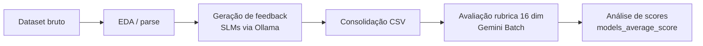

# Documentação dos Notebooks — Feedback com SLMs

**Projeto:** feedback-ia-slm  
**Repositório:** `feedback-open-source`  
**Versão:** 1.0  
**Data:** setembro/2026

---

## 1. Visão geral

Este repositório implementa um pipeline experimental para **gerar feedback educacional automatizado** com Small Language Models (SLMs) locais e **avaliar a qualidade** desse feedback com uma rubrica de 16 dimensões, usando o Gemini como avaliador.

O fluxo completo pode ser resumido em quatro etapas:



| Etapa | Notebooks | Papel |
|-------|-----------|-------|
| Preparação / EDA | `eda_turma_feedback.ipynb` | Explorar dados de tutoria |
| Geração (Biologia) | `*-prova_biologia.ipynb` (×3) | SLMs geram feedback em questões de biologia |
| Geração (Tecnologia) | `*-prova_tecnologia.ipynb` (×3) | SLMs geram feedback em questões de tecnologia |
| Avaliação | `resultado_rubrica.ipynb` | Gemini audita qualidade do feedback |
| Análise | `models_average_score.ipynb` | Médias por modelo e prompt |

---

## 2. Datasets utilizados

| Arquivo | Origem | Uso |
|---------|--------|-----|
| `dados - tutoria/turma_feedback_parsed.csv` | Processado por `parse_feedback.py` | Notebooks de **tecnologia** |
| `dataset-biologia.csv` | Prova de biologia (50 amostras por experimento) | Notebooks de **biologia** |
| `resultados-tecnologia-consolidados_555.csv` | 9 CSVs de SLMs unificados | Entrada do `resultado_rubrica.ipynb` |
| `resultado_rubrica/prova-tecnologia-results-1500-rubrica-16dim.csv` | Saída da rubrica | Entrada do `models_average_score.ipynb` |

---

## 3. Notebooks de preparação de dados

### 3.1 `dados - tutoria/eda_turma_feedback.ipynb`

**Objetivo:** Análise exploratória (EDA) do dataset de feedback real de tutoria.

**Entrada:** `turma_feedback_parsed.csv` (formato longo: uma linha por trecho de feedback).

**O que faz:**
- Carrega e inspeciona estrutura, tipos e valores nulos
- Analisa granularidade (atividades → questões → trechos)
- Distribuições por disciplina, seção, plataforma (Google/Moodle)
- Visualizações de categorias de feedback (ACERTOS, ERROS, etc.)
- Estatísticas de comprimento de texto e qualidade dos dados

**Saída:** Gráficos e tabelas no próprio notebook (não gera CSV de experimento).

**Scripts relacionados:**
- `parse_feedback.py` — converte HTML bruto em CSV estruturado
- `build_eda_notebook.py` — gerador do notebook EDA
- Documentação detalhada em `dados - tutoria/readme.md`

---

## 4. Notebooks de geração de feedback (Biologia) - primeiro teste com amostra menor

Pipeline idêntico nos três notebooks; muda apenas o **modelo Ollama** e o **nome do CSV de saída**.

| Notebook | Modelo Ollama | Pasta de resultados |
|----------|---------------|---------------------|
| `qwen3-prova_biologia.ipynb` | `qwen3:4b` | `qwen3 - resultados/biologia/` |
| `phi4-mini-prova_biologia.ipynb` | `phi4-mini:3.8b` | `phi4-mini - resultados/biologia/` |
| `gemma34b-prova_biologia.ipynb` | `gemma3:4b` | `gemma3 - resultados/gemma34b/` |

**Entrada:** `dataset-biologia.csv`  
Colunas: `question_id`, `answer_text`, `grade`, `question`, `concept`, `reference_answer`

**Amostragem:** 50 linhas (`random_state=123`)

**Prompts (3 variantes teóricas):**
- **Base** — domínio da língua + proximidade com referência
- **Nicol** — boas práticas de Nicol & McFarlane-Dick (2006)
- **Hattie** — feed-up / feedback / feed-forward (Hattie & Timperley)

> Em cada execução, apenas **uma** variante é ativa (alterar `nome_arquivo_csv` e o prompt no loop).

**API:** Ollama local (`http://localhost:11434/api/generate`)  
**Saída JSON:** `{"feedback": "..."}` via schema estruturado

**CSV gerado (exemplo):** `qwen3_prova-biologia-results-50-hattie.csv`  
Colunas: `question`, `answer_text`, `reference_answer`, `concept`, `feedback`

**Documentação específica:** `DOCUMENTACAO-qwen3-prova_biologia.md`

---

## 5. Notebooks de geração de feedback (Tecnologia)

Mesma estrutura dos notebooks de biologia, mas com dataset e amostra maiores.

| Notebook | Modelo Ollama | Amostra |
|----------|---------------|---------|
| `qwen3-prova_tecnologia.ipynb` | `qwen3:4b` | 555 linhas |
| `phi4-mini-prova_tecnologia.ipynb` | `phi4-mini:3.8b` | 555 linhas |
| `gemma4-prova_tecnologia.ipynb` | `gemma4` | 555 linhas |

**Entrada:** `dados - tutoria/turma_feedback_parsed.csv`  
Colunas relevantes: `pergunta`, `resposta_aluno`, `explicacao`, `disciplina`

**Prompts:** Base, Nicol e Hattie (versão adaptada para o contexto de tecnologia/computação).

**CSV gerado (exemplo):** `qwen3_provas-tecnologia-results-550-base.csv`  
Colunas: `pergunta`, `resposta_aluno`, `explicacao`, `disciplina`, `feedback`

**Consolidação:** Os 9 CSVs (3 modelos × 3 prompts) foram unificados em:
- `resultados-tecnologia-consolidados.csv` (4995 linhas)
- `resultados-tecnologia-consolidados_555.csv` (versão usada na rubrica)

---

## 6. Notebook de avaliação da rubrica

### `notebooks/resultado_rubrica.ipynb`

**Objetivo:** Avaliar automaticamente a **qualidade do feedback gerado pelos SLMs**, usando o Gemini como auditor independente.

**Entrada:** `resultados-tecnologia-consolidados_555.csv`  
Colunas: `modelo`, `prompt_variant`, `pergunta`, `resposta_aluno`, `explicacao`, `disciplina`, `feedback`

**Amostragem:** 1500 linhas, balanceadas entre os 3 modelos (`gemma4`, `phi4-mini`, `qwen3`) — ~500 por modelo.

**Prompt de avaliação:** Rubrica de **16 dimensões** em 3 blocos:

| Bloco | Dimensões | Escala |
|-------|-----------|--------|
| Conteúdo | alinhamento, especificidade, tom, pontos fortes/fracos, legibilidade | 0–2 |
| Efetividade | feed-up, feed-back, feed-forward, tarefa, processo, autorregulação, eu | 0–1 |
| Alucinações | conflito com entrada, contexto, fatos | 0–1 |

**API:** Gemini Batch API (`gemini-2.5-flash`) via `google.genai`  
**Modo:** Mini-batches de 250 requests, com pausa entre jobs e retomada via `batch_rubrica_progress.json`

**Saída:** `resultado_rubrica/prova-tecnologia-results-1500-rubrica-16dim.csv`  
Colunas originais + `analise_feedback` (JSON completo da rubrica)

**Estrutura do JSON de saída:**
```json
{
  "conteudo": { "alinhamento_objetivos": {"score": 2, "justificativa": "..."}, ... },
  "efetividade": { "feed_up": {"score": 1, "justificativa": "..."}, ... },
  "alucinacoes": { "conflito_entrada": {"score": 0, "justificativa": "..."}, ... },
  "resumo_avaliacao": {
    "pontuacao_conteudo": 11,
    "pontuacao_maxima_conteudo": 12,
    "componentes_efetividade_presentes": 4,
    "total_componentes_efetividade": 7,
    "alucinacoes_detectadas": 0,
    "principais_observacoes": "..."
  }
}
```

---

## 7. Notebook de análise agregada

### `notebooks/models_average_score.ipynb`

**Objetivo:** Calcular **scores médios** por modelo SLM e variante de prompt, a partir da avaliação da rubrica.

**Entrada:** `resultado_rubrica/prova-tecnologia-results-1500-rubrica-16dim.csv`

**Processamento:**
1. Lê o CSV consolidado (já contém `modelo` e `prompt_variant`)
2. Extrai `average_score` do JSON em `analise_feedback`:
   - Média das 16 dimensões normalizada para escala **0–2**
   - Conteúdo (0–2), efetividade (×2), alucinações (invertido: sem alucinação = 2)
3. Ignora linhas com erro de batch (`"erro"` no JSON)
4. Agrupa por `modelo` × `rubrica` (Base / Nicol / Hattie)
5. Gera tabela pivot para comparação visual

**Saídas (no notebook):**
- `tabela_modelo_rubrica` — média e contagem por grupo
- `tabela_modelo_rubrica_pivot` — matriz modelo × prompt

---

## 8. Mapa de dependências entre notebooks

```
eda_turma_feedback.ipynb
    └── turma_feedback_parsed.csv
            ├── qwen3-prova_tecnologia.ipynb  ──┐
            ├── phi4-mini-prova_tecnologia.ipynb ├──► resultados-tecnologia-consolidados_555.csv
            └── gemma4-prova_tecnologia.ipynb ──┘
                        │
                        ▼
              resultado_rubrica.ipynb (Gemini Batch)
                        │
                        ▼
        prova-tecnologia-results-1500-rubrica-16dim.csv
                        │
                        ▼
              models_average_score.ipynb


dataset-biologia.csv
    ├── qwen3-prova_biologia.ipynb  ──┐
    ├── phi4-mini-prova_biologia.ipynb ├──► resultados-consolidados.csv (biologia)
    └── gemma34b-prova_biologia.ipynb ──┘
```

---

## 9. Pré-requisitos por tipo de notebook

### Geração (Biologia / Tecnologia)
- Python 3.x + `pandas`, `requests`
- [Ollama](https://ollama.com/) rodando localmente
- Modelos baixados: `qwen3:4b`, `phi4-mini:3.8b`, `gemma3:4b` ou `gemma4`

### Avaliação (resultado_rubrica)
- `google-genai` SDK
- `GOOGLE_API_KEY` no `.env`
- Créditos/quota Gemini (Batch API)

### Análise (models_average_score)
- `pandas`, `json`
- Apenas leitura do CSV da rubrica

---

## 10. Artefatos gerados (resumo)

| Artefato | Gerado por | Descrição |
|----------|------------|-----------|
| `*-prova-biologia-results-50-*.csv` | Notebooks biologia | Feedback SLM × biologia |
| `*_prova-tecnologia-results-555-*.csv` | Notebooks tecnologia | Feedback SLM × tecnologia |
| `resultados-tecnologia-consolidados_555.csv` | Script manual / agente | 9 CSVs unificados |
| `resultado_rubrica/prova-tecnologia-results-1500-rubrica-16dim.csv` | resultado_rubrica | Avaliação 16 dim |
| `resultados-consolidados.csv` | Script manual | Biologia unificada (legado) |

---

## 11. Como reproduzir o pipeline completo (tecnologia)

1. **EDA** (opcional): executar `eda_turma_feedback.ipynb`
2. **Geração:** para cada SLM, rodar o notebook `*-prova_tecnologia.ipynb` com as 3 variantes de prompt (base, nicol, hattie)
3. **Consolidar:** unir os 9 CSVs em `resultados-tecnologia-consolidados_555.csv`
4. **Avaliar:** executar `resultado_rubrica.ipynb` (células 0 → 15; pode levar horas)
5. **Analisar:** executar `models_average_score.ipynb` (células 0 → 5)

---

## 12. Referências teóricas

- **Nicol, D. J., & Macfarlane-Dick, D. (2006).** Formative assessment and self-regulated learning. *Studies in Higher Education*, 31(2), 199–218.
- **Hattie, J., & Timperley, H. (2007).** The power of feedback. *Review of Educational Research*, 77(1), 81–112.

---

## 13. Documentação complementar

- `DOCUMENTACAO-qwen3-prova_biologia.md` — detalhes do notebook de biologia Qwen3
- `dados - tutoria/readme.md` — pipeline de dados de tutoria (dissertação, etapa 1)

---

*Documento gerado com base na estrutura atual dos notebooks em `notebooks/` e `dados - tutoria/`.*
