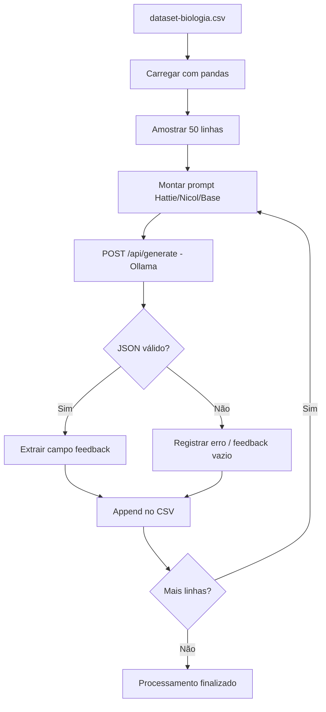

# Documentação: Geração de Feedback com SLMs — Prova de Biologia

**Projeto:** feedback-ia-slm  
**Repositório:** `feedback-open-source`  
**Notebook:** `notebooks/qwen3-prova_biologia.ipynb`  
**Modelo avaliado:** Qwen3 4B (`qwen3:4b`) via Ollama  
**Data de referência:** julho/2026  
**Versão do documento:** 1.0

---

## 1. Resumo executivo

Este experimento avalia a capacidade de um **Small Language Model (SLM)** — Qwen3 4B — em gerar **feedback educacional automatizado** para respostas de alunos em questões de Biologia.

O pipeline:
1. Carrega um dataset de respostas reais de alunos
2. Seleciona uma amostra estratificada de 50 itens
3. Envia cada item a um prompt baseado em teorias de feedback educacional
4. Recebe a resposta em JSON estruturado via API Ollama
5. Persiste os resultados em CSV para análise posterior

O mesmo desenho experimental é replicado para outros modelos (`phi4-mini`, `gemma3`) em notebooks paralelos, permitindo comparação entre SLMs.

---

## 2. Objetivo da pesquisa

Gerar feedback textual que:
- Seja **claro, respeitoso e didático**
- Compare a resposta do aluno com uma **resposta de referência**
- Siga frameworks reconhecidos de feedback educacional
- Respeite restrições de formato (JSON + limite de extensão)

### Frameworks de prompt testados

| Variante | Base teórica | Arquivo de saída esperado |
|----------|--------------|---------------------------|
| `base` | Domínio da língua + proximidade com referência | `qwen3_prova-biologia-results-50-base.csv` |
| `nicol` | Nicol & McFarlane-Dick (2006) | `qwen3_prova-biologia-results-50-nicol.csv` |
| `hattie` | Hattie & Timperley (feed-up / feedback / feed-forward) | `qwen3_prova-biologia-results-50-hattie.csv` |

> **Estado atual do notebook:** apenas a variante `hattie` está ativa no loop de execução, embora as três estejam definidas.

---

## 3. Estrutura do repositório

```
feedback-open-source/
├── dataset-biologia.csv              # Dataset principal
├── notebooks/
│   ├── qwen3-prova_biologia.ipynb    # Este notebook
│   ├── phi4-mini-prova_biologia.ipynb
│   └── gemma34b-prova_biologia.ipynb
├── qwen3 - resultados/
│   ├── qwen3_prova-biologia-results-50-base.csv
│   ├── qwen3_prova-biologia-results-50-nicol.csv
│   └── qwen3_prova-biologia-results-50-hattie.csv
├── phi4-mini - resultados/
└── gemma3 - resultados/
```

---

## 4. Pré-requisitos

### Software
- Python 3.x
- Jupyter Notebook / VS Code / Cursor
- [Ollama](https://ollama.com/) instalado e em execução

### Dependências Python
```
pandas
requests
```

### Modelo Ollama
```bash
ollama pull qwen3:4b
ollama serve   # deve estar rodando em http://localhost:11434
```

### Verificação rápida
```bash
curl http://localhost:11434/api/tags
```

---

## 5. Dataset de entrada

**Arquivo:** `dataset-biologia.csv`  
**Separador:** `;` (detectado automaticamente via `sep=None, engine="python"`)

### Esquema das colunas

| Coluna | Tipo | Descrição |
|--------|------|-----------|
| `question_id` | int | Identificador da questão |
| `answer_text` | string | Resposta textual do aluno |
| `grade` | int (1–3) | Nota atribuída à resposta |
| `question` | string | Enunciado da questão |
| `concept` | string | Conceito avaliado |
| `reference_answer` | string | Resposta ideal de referência |

### Amostragem
- **Tamanho:** 50 respostas
- **Método:** `provas.sample(50, random_state=123)`
- **Reprodutibilidade:** `random_state=123` garante mesma amostra entre execuções

### Problema conhecido no carregamento
O pandas pode ler a coluna como `question_id` (BOM UTF-8).  
**Correção recomendada:** `encoding="utf-8-sig"` na leitura.

---

## 6. Arquitetura do pipeline



---

## 7. Configuração da API Ollama

| Parâmetro | Valor | Descrição |
|-----------|-------|-----------|
| `url` | `http://localhost:11434/api/generate` | Endpoint de geração |
| `model` | `qwen3:4b` | Modelo local |
| `stream` | `false` | Resposta completa de uma vez |
| `think` | `false` | Desativa modo de raciocínio explícito |
| `format` | JSON Schema | Força saída estruturada |
| `temperature` | `0.2` | Baixa variabilidade |
| `num_predict` | `150` | Máximo de tokens gerados |
| `seed` | `123` | Reprodutibilidade parcial |
| `timeout` | `180s` | Timeout por requisição |
| `sleep` | `1s` | Pausa entre requisições |

### Schema JSON de saída

```json
{
  "type": "object",
  "properties": {
    "feedback": { "type": "string" }
  },
  "required": ["feedback"],
  "additionalProperties": false
}
```

---

## 8. Estrutura do notebook (células)

| Célula | Conteúdo | Função |
|--------|----------|--------|
| 0 | Imports | `pandas`, `requests`, `json`, `csv`, `os`, `time` |
| 1 | Config API | URL e nome do modelo |
| 2 | Leitura CSV | Carrega dataset e exibe `head()` |
| 3 | Amostragem | 50 linhas + lista de conceitos |
| 4 | `base_prompt` | Template prompt base |
| 5 | `nicol_prompt` | Template Nicol & McFarlane-Dick |
| 6 | `hattie_prompt` | Template Hattie & Timperley |
| 7 | Nome do arquivo | CSV de saída |
| 8 | Schema + cabeçalhos | JSON schema e colunas do CSV |
| 9 | Loop principal | Geração e persistência dos feedbacks |

---

## 9. Template de prompt (estrutura comum)

Todos os prompts seguem o mesmo molde de contexto:

```
CONCEITO:      {concept}
PERGUNTA:      {question}
RESPOSTA DO ALUNO:     {answer_text}
RESPOSTA IDEAL:        {reference_answer}
```

### Restrições pedidas ao modelo
- Linguagem clara, respeitosa e não genérica
- Não inventar informações
- Máximo de **2 sentenças**, cada uma com até **20 palavras**
- Saída exclusivamente em **JSON válido**

### Variante Hattie (ativa)
Contempla implicitamente:
- **Feed-up:** o que a competência exige
- **Feedback:** diagnóstico da resposta atual
- **Feed-forward:** próximos passos de melhoria

---

## 10. Arquivo de saída

**Nome padrão (Hattie):** `qwen3_prova-biologia-results-50-hattie.csv`  
**Localização esperada:** `qwen3 - resultados/`  
**Modo de escrita:** append (`"a"`) com `flush()` após cada linha

### Colunas exportadas

| Coluna | Origem |
|--------|--------|
| `question` | Dataset |
| `answer_text` | Dataset |
| `reference_answer` | Dataset |
| `concept` | Dataset |
| `feedback` | Gerado pelo modelo |

### Colunas ausentes (recomendadas)
- `question_id`
- `grade`
- `prompt_variant`
- `modelo`
- `timestamp`
- `latency_ms`

---

## 11. Como executar

### Passo a passo
1. Iniciar Ollama: `ollama serve`
2. Confirmar modelo: `ollama list` → `qwen3:4b`
3. Abrir `notebooks/qwen3-prova_biologia.ipynb`
4. Executar células em ordem (0 → 9)
5. Aguardar processamento das 50 respostas (~1–3 min + latência do modelo)
6. Verificar CSV gerado

### Para trocar de variante de prompt
1. Alterar `nome_arquivo_csv` (célula 7)
2. Trocar `hattie_prompt` por `base_prompt` ou `nicol_prompt` (célula 9)
3. Reexecutar células 7–9

---

## 12. Tratamento de erros

A função `gerar_feedback_qwen3()` trata:

| Situação | Comportamento |
|----------|---------------|
| Resposta HTTP com erro | `raise_for_status()` → exceção capturada no loop |
| JSON inválido | Imprime resposta bruta; retorna `""` |
| Resposta vazia | Imprime aviso; exibe trecho do campo `thinking` se existir |
| Erro genérico por linha | Log no console; continua próxima linha |

---

## 13. Resultados observados (Hattie)

Com base em `qwen3_prova-biologia-results-50-hattie.csv`:

### Pontos positivos
- JSON geralmente válido
- Feedback contextualizado ao conceito e à resposta do aluno
- Estrutura Feed-up/Feedback/Feed-forward frequentemente presente

### Limitações observadas
- **Limite de extensão ignorado:** muitos feedbacks ultrapassam 2 sentenças curtas
- **Estrutura explícita demais:** modelo repete rótulos "Feed-up:", "Feedback:", "Feed-foward:"
- **Typo propagado:** "feed-foward" (deveria ser "feed-forward")
- **Respostas genéricas** em casos de "não sei" do aluno
- **Ortografia do aluno** às vezes corrigida no feedback (pode ou não ser desejável)

---

## 14. Limitações técnicas do notebook

| Limitação | Impacto | Prioridade |
|-----------|---------|------------|
| Caminho absoluto do CSV | Quebra em outras máquinas | Alta |
| Sem retomada (resume) | Reexecução duplica linhas | Alta |
| 3 prompts definidos, 1 usado | Confusão operacional | Média |
| `grade` e `question_id` descartados | Perde rastreabilidade analítica | Média |
| Sem validação pós-geração | Não mede aderência às regras | Média |
| Sem célula de análise | Pipeline incompleto | Média |
| Código duplicado entre notebooks | Manutenção difícil | Baixa |

---

## 15. Recomendações de melhoria

### Curto prazo
1. Centralizar configuração (`CONFIG` dict no topo)
2. Usar caminhos relativos com `pathlib`
3. Corrigir leitura com `encoding="utf-8-sig"`
4. Selecionar prompt por variável (`base` / `nicol` / `hattie`)
5. Implementar checkpoint para não reprocessar linhas já salvas

### Médio prazo
6. Incluir `question_id`, `grade`, `modelo`, `prompt_variant` no CSV
7. Validar contagem de palavras/frases após geração
8. Adicionar retry com backoff para falhas de rede
9. Célula final de análise exploratória

### Longo prazo
10. Extrair lógica comum para `scripts/gerar_feedback.py`
11. Comparar automaticamente os 3 modelos × 3 prompts
12. Métricas automáticas (BLEU, similaridade semântica, alinhamento com `grade`)

---

## 16. Comparabilidade entre modelos

| Notebook | Modelo Ollama | Pasta de resultados |
|----------|---------------|---------------------|
| `qwen3-prova_biologia.ipynb` | `qwen3:4b` | `qwen3 - resultados/` |
| `phi4-mini-prova_biologia.ipynb` | `phi4-mini:3.8b` | `phi4-mini - resultados/` |
| `gemma34b-prova_biologia.ipynb` | `gemma3:4b` | `gemma3 - resultados/` |

Todos compartilham:
- Mesmo dataset e amostra (`random_state=123`)
- Mesmos 3 templates de prompt
- Mesmo schema JSON de saída
- Mesmos hiperparâmetros Ollama

Isso permite comparação controlada entre SLMs.

---

## 17. Referências teóricas

- **Nicol, D. J., & Macfarlane-Dick, D. (2006).** Formative assessment and self-regulated learning: A model and seven principles of good feedback practice. *Studies in Higher Education*, 31(2), 199–218.
- **Hattie, J., & Timperley, H. (2007).** The power of feedback. *Review of Educational Research*, 77(1), 81–112.

---

## 18. Glossário

| Termo | Definição |
|-------|-----------|
| **SLM** | Small Language Model — modelo de linguagem compacto para execução local |
| **Ollama** | Runtime local para servir modelos LLM/SLM |
| **Feed-up** | Esclarecimento do objetivo/competência esperada |
| **Feed-forward** | Orientação sobre próximos passos de melhoria |
| **JSON Schema** | Contrato de formato que força estrutura na resposta do modelo |

---

## 19. Histórico de versões

| Versão | Data | Alteração |
|--------|------|-----------|
| 1.0 | jul/2026 | Documentação inicial baseada na análise do notebook |

---

*Documento gerado a partir da análise de `notebooks/qwen3-prova_biologia.ipynb` e artefatos em `qwen3 - resultados/`.*
